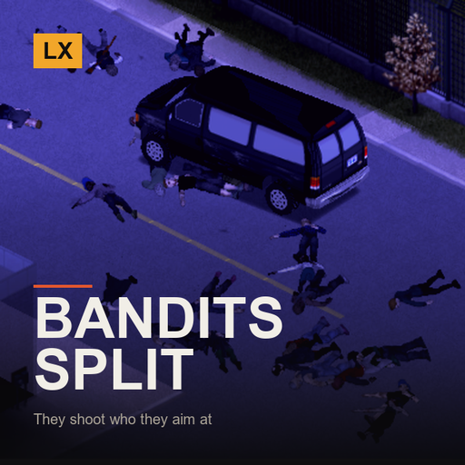

# LX Bandits Split-Screen Fix

**Bandits that shoot at the player they are actually looking at**

> In split-screen every bandit action landed on player 1, whoever it was aimed at. Player 2 was a ghost that took no hits and dealt no consequences.

`Project Zomboid B42.21+` · `v1.0.0` · `CC0`

[English](#english) · [Español](#español) · [Русский](#русский)

---

## English

This mod is part of the **LX Split-Screen Suite**, seven mods that make Project Zomboid B42 playable in 2–4 player couch co-op, with or without a gamepad. Each one stands alone — install only what you need.

### Why split-screen?

Split-screen is the mode that carries the most bugs in stable B42 — and the mods worth playing with, like Bandits and Project A-Life, are built for singleplayer and online multiplayer. Nobody is fixing couch co-op. This suite exists to close that gap: to make split-screen as playable as the modes that get the attention.

### Why gamepad?

B42 keeps improving controller support, but it is still rough, and the aim-and-shoot rework left gunplay on a gamepad close to unusable — you cannot even shoot a zombie lying on the ground. Split-screen *with* a gamepad is the worst case the game offers. These mods give PZ back an aim that was designed for a stick: assist on the vertical axis, B41-style lock-on, per-player aim state, and a lot more.

### What it does

- **Damage goes to the right player** — Bandits detect, chase, hit, shoot and shove whoever they are actually engaging, instead of routing everything through player 1. Shoving in particular now only reaches a player who is genuinely next to the bandit.
- **Players stop being indistinguishable** — Outside online multiplayer, Bandits gave every player the same character ID — literally the number 1. Player 2 was not a separate person to the AI. Each local player now has a stable ID, and player 1 keeps the old one so existing saves carry over.
- **Visibility uses your own light** — How visible a character is was always computed with player 1's light level, which includes player 1's vision cone. Now each player is judged by their own.
- **Companions follow who recruited them** — A recruited companion followed player 1 no matter who recruited them. Now they follow their own master, falling back to the nearest living local player.
- **Raids and ambient AI spread out** — Raids spawn around any player. Bandit chatter, endurance and task sounds use the nearest player instead of player 1. The kill counter on the character screen shows that screen's player's kills.
- **Bandits investigate noise from anyone *(optional)*** — When any local player makes a loud noise — a gunshot, an alarm, banging on a door — hostile bandits that heard it remember the spot and go check it. Bandits already walks to a remembered position when it cannot see anyone; this just makes both players able to create one. Toggle and noise threshold in the options.

### Requirements

| Mod | Workshop | |
|---|---|---|
| Bandits | [3268487204](https://steamcommunity.com/sharedfiles/filedetails/?id=3268487204) | required |

**Load order:** load this **after** `Bandits2`. `mod.info` already declares it.

### Installing

**From the Steam Workshop (recommended)**
Subscribe on the Workshop page. Steam downloads it; then start Project Zomboid, go to
**Mods** in the main menu and enable it. In split-screen, enabling it once covers all players.

**Manually**
1. Download this repository (green **Code** button -> **Download ZIP**) and unzip it.
2. Copy the folder `LX_BanditsSplit` into your Zomboid mods folder:
   - Windows: `C:\Users\<you>\Zomboid\mods\`
   - Linux: `~/Zomboid/mods/`
   - macOS: `~/Library/Application Support/Zomboid/mods/`
   The result must be `...\Zomboid\mods\LX_BanditsSplit\42\mod.info`.
3. Start the game, open **Mods** in the main menu and enable **LX Bandits Split-Screen Fix**.

### Options

Options → MODS → **LX Bandits Split-Screen Fix**. The split-screen fixes are always on; the options only control the optional noise-investigation AI and its minimum noise radius.

### Notes

- **Bandits' own files are never shipped or overwritten.** They are read from your installed copy at load time, patched in memory and run from there — so this always runs on top of whatever Bandits version you have, and nothing of Bandits is redistributed.
- Each patch is matched against an exact expected snippet. If Bandits updates and a snippet no longer matches, that one patch is skipped with a note in `console.txt` and the original code runs unchanged.
- A summary of how many patches applied is printed in `console.txt` at game start.
- Must load **after** Bandits. `loadModAfter` already declares this.

### License

**CC0 1.0 Universal** — public domain dedication. Do whatever you want with it: copy it, change it, put it in a modpack, publish it, sell it. No permission needed, no credit required (though it is always welcome). See `LICENSE`.

### Support

If these mods made your co-op run work, you can buy me a coffee — [ko-fi.com/litoxperaloca](https://ko-fi.com/litoxperaloca)

### The rest of the suite

- [LX Coop Fixes](https://github.com/litoxperaloca/LX_CoopFixes) — Split-screen stability: vehicle crash, player 2 aiming, map stutter, error spam.
- [LX Split Aim](https://github.com/litoxperaloca/LX_SplitAim) — Controller aim assist and B41-style lock-on, per local player.
- [LX Split-Screen Quick Build](https://github.com/litoxperaloca/LX_SPLITSCREEN_CONTEXTMENU_BUILDING) — B41-style build menu in the context menu, because B42's window does not fit.
- [LX A-Life Split-Screen Fix](https://github.com/litoxperaloca/LX_ALifeSplit) — Project A-Life NPCs react to every local player, not just player 1.
- [LX Split-Screen Welcome Package](https://github.com/litoxperaloca/LX_SPLITSCREEN_WELCOME_PACKAGE) — A configurable starter kit per local character.
- [LX Split-Screen Skills Boost](https://github.com/litoxperaloca/LX_SPLITSCREEN_SKILLS_IMPROVE) — A configurable skill floor per local character.
- [LX Theodore Split-Screen Fix](https://github.com/litoxperaloca/LX_TheodoreSplit) — Theodore, the family NPC, reacts to every local player and works with a gamepad.

---

## Español

> En pantalla dividida toda acción de los bandidos caía sobre el jugador 1, sin importar a quién apuntaran. El jugador 2 era un fantasma que no recibía golpes ni generaba consecuencias.

Este mod es parte de la **LX Split-Screen Suite**, siete mods que hacen jugable Project Zomboid B42 en coop de sillón de 2 a 4 jugadores, con o sin mando. Cada uno funciona por separado — instalá solo lo que precises.

### ¿Por qué pantalla dividida?

Es la modalidad con más bugs en la B42 estable — y los mods que valen la pena, como Bandits y Project A-Life, están pensados para un jugador y multijugador online. Nadie arregla el coop de sillón. Esta suite existe para cerrar esa brecha: dejar la pantalla dividida a la par de las modalidades que sí reciben atención.

### ¿Por qué mando?

La B42 viene mejorando el soporte de mando, pero todavía deja mucho que desear, y el rework de apuntado y disparo dejó el tiroteo con mando casi imposible — ni siquiera podés dispararle a un zombi en el suelo. Pantalla dividida *con* mando es el peor escenario posible del juego. Estos mods le devuelven a PZ un apuntado pensado para stick: asistencia en el eje vertical, fijado de blanco estilo B41, estado de apuntado por jugador, y bastante más.

### Qué hace

- **El daño va al jugador correcto** — Los bandidos detectan, persiguen, golpean, disparan y empujan a quien realmente están enfrentando, en vez de mandar todo al jugador 1. El empujón en particular ahora solo alcanza a un jugador que esté genuinamente al lado del bandido.
- **Los jugadores dejan de ser indistinguibles** — Fuera del multijugador online, Bandits le daba a todos los jugadores el mismo ID de personaje — literalmente el número 1. Para la IA, el jugador 2 no era otra persona. Ahora cada jugador local tiene un ID estable, y el jugador 1 conserva el viejo así que las partidas existentes siguen funcionando.
- **La visibilidad usa tu propia luz** — Qué tan visible es un personaje se calculaba siempre con el nivel de luz del jugador 1, que incluye su cono de visión. Ahora a cada jugador se lo juzga por el suyo.
- **Los compañeros siguen a quien los reclutó** — Un compañero reclutado seguía al jugador 1 sin importar quién lo hubiera reclutado. Ahora sigue a su propio dueño, y si no, al jugador local vivo más cercano.
- **Las incursiones y la IA de ambiente se reparten** — Las incursiones aparecen alrededor de cualquier jugador. La charla de los bandidos, su resistencia y los sonidos de tareas usan al jugador más cercano en vez del 1. El contador de bajas de la pantalla de personaje muestra las bajas del jugador de esa pantalla.
- **Los bandidos investigan ruidos de cualquiera *(opcional)*** — Cuando cualquier jugador local hace un ruido fuerte — un disparo, una alarma, golpear una puerta — los bandidos hostiles que lo escucharon guardan el lugar y van a revisarlo. Bandits ya camina hasta una posición recordada cuando no ve a nadie; esto solo hace que ambos jugadores puedan generar una. Interruptor y umbral de ruido en las opciones.

### Requisitos

| Mod | Workshop | |
|---|---|---|
| Bandits | [3268487204](https://steamcommunity.com/sharedfiles/filedetails/?id=3268487204) | obligatorio |

**Orden de carga:** cargá este **después** de `Bandits2`. El `mod.info` ya lo declara.

### Instalación

**Desde el Steam Workshop (recomendado)**
Suscribite en la página del Workshop. Steam lo descarga solo; después abrí Project Zomboid,
andá a **Mods** en el menú principal y activalo. En pantalla dividida, con activarlo una vez
alcanza para todos los jugadores.

**A mano**
1. Descargá este repositorio (botón verde **Code** -> **Download ZIP**) y descomprimilo.
2. Copiá la carpeta `LX_BanditsSplit` a tu carpeta de mods de Zomboid:
   - Windows: `C:\Users\<vos>\Zomboid\mods\`
   - Linux: `~/Zomboid/mods/`
   - macOS: `~/Library/Application Support/Zomboid/mods/`
   Tiene que quedar `...\Zomboid\mods\LX_BanditsSplit\42\mod.info`.
3. Abrí el juego, entrá a **Mods** en el menú principal y activá **LX Bandits Split-Screen Fix**.

### Opciones

Opciones → MODS → **LX Bandits arreglo pantalla dividida**. Los arreglos de pantalla dividida están siempre activos; las opciones solo controlan la IA opcional de investigar ruidos y su radio mínimo.

### Notas

- **Los archivos de Bandits nunca se distribuyen ni se pisan.** Se leen de tu copia instalada al cargar, se parchean en memoria y se ejecutan desde ahí — así esto siempre corre sobre la versión de Bandits que tengas, y no se redistribuye nada de Bandits.
- Cada parche se compara contra un fragmento exacto esperado. Si Bandits se actualiza y un fragmento deja de coincidir, ese parche se omite con un aviso en `console.txt` y el código original corre sin cambios.
- Al iniciar la partida se imprime en `console.txt` un resumen de cuántos parches se aplicaron.
- Debe cargar **después** de Bandits. El `loadModAfter` ya lo declara.

### Licencia

**CC0 1.0 Universal** — dedicado al dominio público. Hacé lo que quieras: copialo, cambialo, metélo en un modpack, publicalo, vendelo. No hace falta permiso ni crédito (aunque siempre se agradece). Ver `LICENSE`.

### Apoyar

Si estos mods te arreglaron el coop, podés invitarme un café — [ko-fi.com/litoxperaloca](https://ko-fi.com/litoxperaloca)

### El resto de la suite

- [LX Coop Fixes](https://github.com/litoxperaloca/LX_CoopFixes) — Estabilidad en pantalla dividida: crash de vehículos, apuntado del jugador 2, tirones del mapa, spam de errores.
- [LX Split Aim](https://github.com/litoxperaloca/LX_SplitAim) — Asistencia de apuntado con mando y fijado de blanco estilo B41, por jugador local.
- [LX Split-Screen Quick Build](https://github.com/litoxperaloca/LX_SPLITSCREEN_CONTEXTMENU_BUILDING) — Menú de construcción estilo B41 en el menú contextual, porque la ventana de B42 no entra.
- [LX A-Life Split-Screen Fix](https://github.com/litoxperaloca/LX_ALifeSplit) — Los NPCs de Project A-Life reaccionan a todos los jugadores locales, no solo al 1.
- [LX Split-Screen Welcome Package](https://github.com/litoxperaloca/LX_SPLITSCREEN_WELCOME_PACKAGE) — Un equipo inicial configurable por personaje local.
- [LX Split-Screen Skills Boost](https://github.com/litoxperaloca/LX_SPLITSCREEN_SKILLS_IMPROVE) — Un piso de habilidades configurable por personaje local.
- [LX Theodore Split-Screen Fix](https://github.com/litoxperaloca/LX_TheodoreSplit) — Theodore, el NPC familiar, reacciona a todos los jugadores locales y anda con mando.

---

## Русский

> При разделённом экране любое действие бандита доставалось первому игроку, в кого бы он ни целился. Второй игрок был призраком: не получал ударов и не создавал последствий.

Этот мод входит в набор **LX Split-Screen Suite** — семь модов, которые делают Project Zomboid B42 играбельным в совместной игре на диване для 2–4 человек, с геймпадом или без. Каждый работает сам по себе — ставьте только нужное.

### Почему разделённый экран?

Разделённый экран — режим с наибольшим числом ошибок в стабильной B42, а моды, ради которых стоит играть, вроде Bandits и Project A-Life, сделаны под одиночную игру и сетевой мультиплеер. Совместной игрой на диване не занимается никто. Этот набор существует, чтобы закрыть пробел: сделать разделённый экран таким же играбельным, как режимы, которым достаётся внимание.

### Почему геймпад?

B42 продолжает улучшать поддержку контроллеров, но она всё ещё сырая, а переработка прицеливания и стрельбы сделала перестрелки с геймпада почти невозможными — вы даже не можете выстрелить в зомби, лежащего на полу. Разделённый экран *вместе* с геймпадом — худший случай, который предлагает игра. Эти моды возвращают PZ прицеливание, рассчитанное на стик: помощь по вертикальной оси, захват цели в стиле B41, отдельное состояние прицеливания для каждого игрока и многое другое.

### Что делает

- **Урон достаётся нужному игроку** — Бандиты замечают, преследуют, бьют, стреляют и толкают того, с кем действительно имеют дело, а не отправляют всё первому игроку. Толчок, в частности, теперь достаёт только того игрока, кто по-настоящему стоит рядом с бандитом.
- **Игроки перестают быть неразличимыми** — Вне сетевой игры Bandits выдавал всем игрокам одинаковый идентификатор персонажа — буквально число 1. Для ИИ второй игрок не был отдельным человеком. Теперь у каждого локального игрока свой устойчивый идентификатор, а первый сохраняет прежний, так что существующие сохранения продолжают работать.
- **Видимость считается по вашему свету** — Насколько персонаж заметен, всегда считалось по уровню освещения первого игрока, включающему его конус обзора. Теперь каждого оценивают по его собственному.
- **Напарники следуют за тем, кто их нанял** — Нанятый напарник шёл за первым игроком независимо от того, кто его нанял. Теперь он следует за своим хозяином, а если того нет — за ближайшим живым локальным игроком.
- **Рейды и фоновый ИИ распределяются** — Рейды появляются вокруг любого игрока. Реплики бандитов, их выносливость и звуки задач используют ближайшего игрока, а не первого. Счётчик убийств в окне персонажа показывает убийства игрока этого экрана.
- **Бандиты расследуют шум от любого *(необязательно)*** — Когда любой локальный игрок создаёт громкий звук — выстрел, сигнализацию, удары в дверь — враждебные бандиты, услышавшие его, запоминают место и идут проверить. Bandits и так идёт к запомненной позиции, когда никого не видит; это лишь позволяет обоим игрокам такую позицию создавать. Переключатель и порог громкости в настройках.

### Требования

| Mod | Workshop | |
|---|---|---|
| Bandits | [3268487204](https://steamcommunity.com/sharedfiles/filedetails/?id=3268487204) | обязательно |

**Порядок загрузки:** загружайте этот мод **после** `Bandits2`. `mod.info` уже это объявляет.

### Установка

**Из Steam Workshop (рекомендуется)**
Подпишитесь на странице Workshop. Steam скачает мод сам; затем запустите Project Zomboid,
откройте **Моды** в главном меню и включите его. При разделённом экране достаточно включить
один раз — это работает для всех игроков.

**Вручную**
1. Скачайте этот репозиторий (зелёная кнопка **Code** -> **Download ZIP**) и распакуйте.
2. Скопируйте папку `LX_BanditsSplit` в папку модов Zomboid:
   - Windows: `C:\Users\<вы>\Zomboid\mods\`
   - Linux: `~/Zomboid/mods/`
   - macOS: `~/Library/Application Support/Zomboid/mods/`
   Должно получиться `...\Zomboid\mods\LX_BanditsSplit\42\mod.info`.
3. Запустите игру, откройте **Моды** в главном меню и включите **LX Bandits Split-Screen Fix**.

### Настройки

Настройки → МОДЫ → **LX Bandits: исправление разделённого экрана**. Исправления разделённого экрана работают всегда; настройки управляют только необязательным ИИ расследования шума и минимальным радиусом звука.

### Примечания

- **Файлы Bandits никогда не распространяются и не перезаписываются.** Они читаются из вашей установленной копии при загрузке, патчатся в памяти и запускаются оттуда — поэтому мод всегда работает поверх вашей версии Bandits, и ничего из Bandits не распространяется повторно.
- Каждый патч сверяется с точным ожидаемым фрагментом. Если Bandits обновится и фрагмент перестанет совпадать, именно этот патч пропускается с записью в `console.txt`, а исходный код работает без изменений.
- При запуске игры в `console.txt` выводится сводка о том, сколько патчей применилось.
- Должен загружаться **после** Bandits. `mod.info` уже это объявляет.

### Лицензия

**CC0 1.0 Universal** — передано в общественное достояние. Делайте что угодно: копируйте, изменяйте, включайте в сборки модов, публикуйте, продавайте. Разрешение не требуется, указание авторства не обязательно (но всегда приятно). См. `LICENSE`.

### Поддержать

Если эти моды помогли вашей совместной игре, можете угостить меня кофе — [ko-fi.com/litoxperaloca](https://ko-fi.com/litoxperaloca)

### Остальные моды набора

- [LX Coop Fixes](https://github.com/litoxperaloca/LX_CoopFixes) — Стабильность разделённого экрана: вылет транспорта, прицеливание второго игрока, подтормаживания карты.
- [LX Split Aim](https://github.com/litoxperaloca/LX_SplitAim) — Помощь прицеливания с геймпада и захват цели в стиле B41 для каждого локального игрока.
- [LX Split-Screen Quick Build](https://github.com/litoxperaloca/LX_SPLITSCREEN_CONTEXTMENU_BUILDING) — Меню строительства в стиле B41 в контекстном меню, потому что окно B42 не помещается.
- [LX A-Life Split-Screen Fix](https://github.com/litoxperaloca/LX_ALifeSplit) — NPC из Project A-Life реагируют на всех локальных игроков, а не только на первого.
- [LX Split-Screen Welcome Package](https://github.com/litoxperaloca/LX_SPLITSCREEN_WELCOME_PACKAGE) — Настраиваемый стартовый набор для каждого локального персонажа.
- [LX Split-Screen Skills Boost](https://github.com/litoxperaloca/LX_SPLITSCREEN_SKILLS_IMPROVE) — Настраиваемый минимальный уровень навыков для каждого локального персонажа.
- [LX Theodore Split-Screen Fix](https://github.com/litoxperaloca/LX_TheodoreSplit) — Theodore реагирует на всех локальных игроков и работает с геймпадом.

